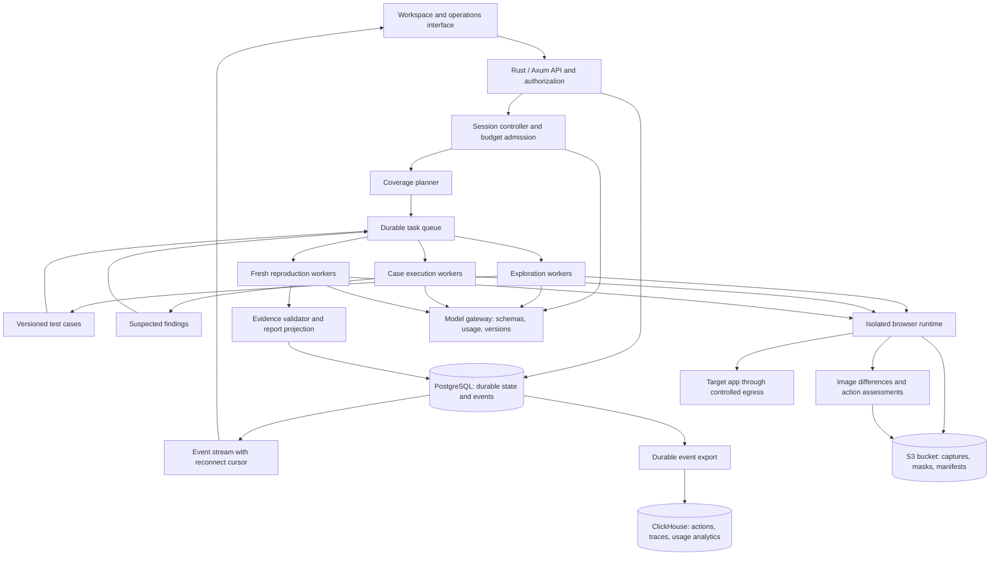

# Building the Scout QA agent

28 October implementation update: [automatic reproduction](../exploration/automatic-reproduction.md) now schedules bounded fresh checks after an opted-in queued exploration completes. Durable reservations, manual/automatic deduplication, provider and evidence deferral, child lineage and independent batch cancellation are implemented. Automatic results preserve the source judgments and still require human review for confirmation. Dataset export, live-model quality evaluation, spend quotas, resume and multiple workers remain future work.

Implementation update: [human finding review](../exploration/finding-reviews.md) adds append-only confirmation, dismissal and reopening, tied to independently reproduced and hash-verified evidence. The original model judgments and fixture training exclusions remain preserved.

26 October implementation update: [durable run cancellation](../exploration/cancellation.md) now stops queued jobs, active exploration and reproduction, including private login. Screenshots and model usage remain available; dispatch checks and restart recovery prevent new actions after cancellation. Resume, multiple workers, live-model quality evaluation and reviewed bug confirmation remain pending.

25 October implementation update: [action completion and safe form journeys](../exploration/action-outcomes.md) now add bounded stability checks, retained screenshot samples, request/console diagnostics, native validation and permitted submission to exploration and reproduction. Live-model evaluation remains unverified.


24 October implementation update: [private app login and encrypted session reuse](../exploration/private-login.md) now support the local queued worker, including optional sign-in, authentication-context resets, authenticated replay and access interruption recovery. Google/external identity providers, parallel public exploration during a handoff and hosted secret management remain pending. Earlier milestone descriptions below are historical/planned scope.

Research date: 14 October 2026; revised to the user's requirements on 15 October and checked for consistency on 21 October 2026. This document defines the application design. The first local storage/observability infrastructure is tracked separately in [Local infrastructure](../platform/infrastructure.md); it must not be confused with a completed browser-testing application.

## Recommended direction

Build a web-first exploratory QA product that starts from **only a URL**. The agent infers likely user goals, explores possible flows, predicts the expected result before each action, checks what actually happened, and independently reproduces suspected failures. Credentials and optional context can be provided later. Use the three-pane workflow in your screenshots as the initial interface.

The first product should make two promises well: **every executed action has a durable evidence trail**, and **a confirmed functional bug has evidence from independent reproduction**. Store captures in a bucket with unique IDs linked to actions, assessments, agents, and workers. Preserve data for later training, with versioned dataset manifests and reviewed labels. Agent counts and test counts measure activity, not quality.

Start with Chromium and responsive desktop/tablet/mobile web layouts. Keep native mobile, broad cross-browser support, repository-aware regression selection, and automatic test maintenance for later. A small reliable engine is the foundation for those features.

Implementation status on 23 October: the data foundation, [browser recorder](../../packages/browser-runtime/README.md), Rust/Axum model gateway, [bounded URL explorer](../exploration/overview.md), [fresh-browser suspect replay](../exploration/reproduction.md), and the [user workspace/operations console](../platform/workspace.md) are implemented. The [frontier planner](../exploration/planner.md) now ranks known paths using model intent, changed clickable controls, novelty and return cost; it returns to branches, replans stale screens and supports three responsive viewport profiles. The explorer links model predictions/assessments, screenshot IDs, exact masks, a state/flow graph and per-user usage. Replay preserves the original expectation, records fresh evidence and separate assessments, and reports reproduced/not reproduced/inconclusive without automatically confirming bugs. TypeScript is retained for Playwright. Tests use real browser/storage services and simulated OpenAI/Claude/OpenRouter responses; live-model QA quality and score calibration, arbitrary-site isolation, reviewed confirmation, credential handoff, cancellation and parallel execution remain unfinished. GUI API/worker integration is verified; visual browser inspection remains unverified after a computer-use restriction.

The 23 October browser-interaction increment also adds native text/search entry, dropdown selection, checkbox/radio changes and document scrolling, with typed argument validation, bounded model context and exact replay parameters. See [browser interactions](../exploration/interactions.md). Form submission, credential handoff and custom widgets are still pending.

Companion specifications:

- [Exploratory QA product reference](./reference.md)
- [Product requirements, schema, APIs, and implementation tickets](./implementation-plan.md)
- [Browser workers, orchestration, recovery, and isolation](../runtime/browser.md)
- [Screenshot evidence and training data](../runtime/evidence.md)
- [Local stack, model connections, and usage accounting](../platform/models.md)

Where companion defaults differ, this document defines delivery scope; the runtime document defines execution invariants; the product document defines the proposed UI/API contract.

## What the reference screenshots establish

| Evidence | What we take from it | Boundary |
| --- | --- | --- |
| The seven supplied screenshots | Session chat; Agents/Test cases/Bugs tabs; search; queued/running/finished work; blockers; browser replay; usage; workspace navigation | The screenshots do not fix the implementation framework, database schema, exact prompts, or simultaneous execution of all listed agents |

The product uses separate coordinator, exploration, case-execution, and reproduction roles, with an isolated browser session per active attempt and independent reproduction before a functional bug is confirmed. Hosted models consume page context and evidence, and runtime validation constrains tool calls. Model IDs, prompts, and quality are chosen and measured in this application. A later selector and snapshot cache can replay stable intent matches; ClickHouse remains the analytical store and PostgreSQL remains the operational database. Exploratory sessions and a later regression library stay separate: converting a discovered flow into a reviewable test is an explicit later step.

The screenshots show 27 running, 123 waiting, and 22 finished agents in one view. That is a queue of tasks with bounded execution. It is not evidence that 172 browsers were running together.

## Proposed system architecture

Everything below is our design recommendation.



| Component | Initial choice | Reason and boundary |
| --- | --- | --- |
| UI | HTML/CSS/JavaScript embedded in Rust for the first local interface | URL launch, run/evidence review, flow map and operations inspection; a component framework can follow when UI complexity warrants it |
| API/control plane | Rust, Axum, Tokio | Auth, typed commands, report retrieval, provider gateway, usage settlement and server-sent events; browser execution stays in workers |
| Durable state | PostgreSQL | Transactions for tasks, evidence links, budgets, event ordering, and tenant ownership |
| Queue | PostgreSQL task leases first; Redis/BullMQ when parallel admission needs it | Keep PostgreSQL authoritative; delivery can repeat without duplicating logical work |
| Browser | Playwright with pinned Chromium | Semantic locators, page snapshots, captures around every action, viewport configuration |
| Isolation | Dedicated sandboxed worker per active attempt for hosted testing | Browser contexts separate cookies/storage; they do not provide a complete tenant security boundary |
| Artifacts | S3-compatible bucket; SeaweedFS locally | Lossless screenshots, change masks, model payload references, action logs, dataset manifests; unique capture IDs and hash-based blob deduplication |
| Models | OpenAI, Anthropic, OpenRouter and Meta AI adapters with explicit authentication modes | API credentials; eligible ChatGPT plan usage; separate native Claude Code option; free-only OpenRouter routing with capability validation; Meta Responses API with `store: false` |
| Context | Inferred goals and expectations, versioned observations, optional later user guidance | Start without a brief; mark inferred expectations and preserve their source and uncertainty |
| Observability | ClickHouse plus OpenTelemetry; durable export of domain events | Correlate session → run → flow → attempt → action → prediction → captures → assessment → model request |
| Local deployment | Docker Compose plus just; Kubernetes parity later | One machine, repeatable commands, persistent volumes; reuse service images and contracts on Kubernetes |
| CPU-intensive image work | Existing exact-diff module; Rust port if profiling warrants it | Benchmark before replacing the tested algorithm; preserve parity fixtures |

Use a Rust web/API process and a separate browser-worker process under Docker Compose with a `justfile` for development commands. Add a kind environment to validate Kubernetes deployment after these service boundaries stabilize; keep the same images and evidence contracts. The current development stack includes PostgreSQL, ClickHouse, S3-compatible storage, and one durable browser worker. The frontend has no build step or separate Node web server; long browser jobs run outside the API request lifecycle. [Deployment decisions](../platform/deployment.md), [Playwright isolation](https://playwright.dev/docs/browser-contexts).

Rust is selected for the API/control plane following the user's preference. It can reduce CPU overhead and memory use, but no benchmark establishes a faster whole QA run than Node. Browser navigation and model calls are likely major latency contributors. TypeScript remains at the Playwright boundary; rewriting it solely for language uniformity would not establish a performance gain. Use Python later where evaluation/training libraries make it useful.

## How one session works

1. **Accept the URL.** Apply saved viewport, model, budget, and exploration defaults. No brief is required. Persist an immutable run configuration and the first observation.
2. **Check access.** Detect login, account creation, paid access, unavailable targets, and bot challenges. The user can supply credentials or create/sign in to a test account through a controlled browser handoff. At a paywall, request an already entitled account and continue other flows; do not buy or subscribe automatically.
3. **Infer likely goals.** From visible controls, content, route, and previous context, propose likely user intentions. Prioritize common flows, new states, risk, and cost while reserving some coverage for uncommon branches. Likelihood scores are model estimates, not measured user behavior.
4. **Explore a state graph.** Record exact state observations and action edges; flows are paths through the graph. A tree can be a UI view, but cycles and converging paths require a graph. Preserve every observation even when grouping similar states for planning.
5. **Predict, execute, and assess every action.** Freeze the expected result and its justification before acting; capture before/after images; compute the change mask; evaluate the action using full-page context, changed regions, DOM/accessibility differences, URL, and relevant network/console observations. This applies to clicks, typing, selection, scrolling, navigation, waits, failed actions, and actions with no visible change.
6. **Classify the outcome.** A case is verified only when all required acceptance criteria are evidenced and no required coverage remains unverified. An unavailable dependency or missing credential produces a blocker. A worker crash is an infrastructure error. A suspected product failure enters reproduction.
7. **Reproduce independently.** Start a new browser attempt and recreate equivalent preconditions. Give the reproducer the claim and steps but require fresh observed evidence. Fresh browser state alone is insufficient if the target backend shares mutable test data.
8. **Publish the report.** Validate evidence, merge duplicates, show unresolved candidates and coverage gaps, and record the actual resource usage. A finished session can still have blocked or untested cases.

The controller owns durable transitions and accounting. The LLM proposes plans and actions; it cannot directly mark a bug confirmed, mint unbounded workers, overwrite acceptance criteria, or bypass budgets.

## Agent runtime contract

Start with a compact tool surface: `observe`, `navigate`, `click`, `fill`, `select`, `press`, `scroll`, `wait_for`, `assert`, `capture_evidence`, `record_case`, `report_candidate`, and `request_input`. Target references must come from a recent observation; stale references require a new observation. Credentials are opaque references filled by the runtime, not plaintext echoed through chat.

Prefer role/name or stable test locators. Screenshots are mandatory evidence around every browser action, including tiny and zero-visible-change outcomes. All actions receive a recorded assessment; a missing capture or assessment is explicit incomplete work and prevents silent advancement. Bound waits, retries, navigation depth, action count, and model context. Detect loops without dropping the evidence of repeated actions.

For assertions, use exact checks where possible—URL, text, visibility, counts, network response—and model-assisted judgments only when needed. Reproduction does not prove the expectation is correct: a consistently missing feature can be intended behavior. If product intent is ambiguous, keep the finding awaiting clarification.

Freeze the case's acceptance criteria before execution. Navigation recovery may find an alternate route, but it must not weaken the assertion to turn a failure into a pass. Later regression exports need stable setup, typed steps, and reviewable expected results.

## Screenshot storage, differences, and training

Each capture occurrence gets a unique `capture_id`; each action gets an `action_id` and references its `before_capture_id`, `after_capture_id`, `prediction_id`, `diff_artifact_id`, and `check_id`. Use content hashes to avoid storing identical image bytes twice while preserving separate capture identities and timestamps. Actions record their exact submitted arguments after secret substitution is redacted, outcomes, errors, retries, and causal links.

Save the original lossless images and a derived absolute-difference mask. Compare matching viewport geometry and record scroll, zoom, device scale, and timing. Keep a raw pixel mask plus optional noise-ranked views; a small changed area must not be discarded automatically. Fonts, cursors, animations, loading indicators, and live charts can produce differences without defects. Conversely, an unchanged button response or a changed backend state can indicate a problem without a large visual difference. The mask directs attention; it is not the bug verdict.

Capture a bounded sequence for transitions that matter, such as an immediate result and a settled result. Record the sampling schedule and any missed/failed captures. Discrete screenshots do not guarantee capture of every transient frame; video remains an optional diagnostic for timing/animation problems. Default recording is screenshots plus structured action/event data, not continuous video.

Storage must be measured. Illustratively, 100 actions with two 300 KB captures each produce 60 MB before masks, manifests, and deduplication. At 1,000 such runs that is 60 GB. Video can sometimes compress more efficiently, but its bytes depend on bitrate and duration; it is not inherently always larger. Preserve lossless screenshot evidence for training and offer derived previews separately.

Training exports retain observations, actions, predictions, assessments, model/prompt versions, reproduction results, and human corrections. Keep inferred, machine-assessed, reproduced, and human-reviewed labels distinct. Record public/provider-exposed model outputs and tool decisions; never manufacture hidden model reasoning. Credentials and auth tokens are excluded. No automatic evidence expiry in development; introduce disk alerts, backup/export, and an explicit retention decision before deleting training candidates. The seven supplied design-reference screenshots are labeled separately from runtime observations.

## UI and reporting scope

The first implemented interface has Workspace and Operations navigation, URL-only launch, run review, action evidence, a flow map, manual reproduction, jobs, model calls, event logs and usage. It polls durable API snapshots every five seconds. Conversation, server-sent events, credential handoff, cancellation, scheduling, multiple workers and separate admin roles remain future work. The table below describes the broader pilot scope.

Preserve the information architecture of the reference: workspace sidebar; session header with counts/status/cost; chat and activity on the left; searchable agent, case, and bug lists on the right. Details open into an evidence view with expected/actual behavior, steps, viewport, build reference, and replay.

| First pilot | Follow-up | Defer until demand is proven |
| --- | --- | --- |
| URL-only exploration; inferred goals; cases; three responsive viewports | Recurring schedules and CI triggers | Native iOS/Android execution |
| Three worker roles plus coordinator; queue/running visibility | Repository diff context and versioned knowledge retrieval | Broad browser/device matrix |
| Evidence and independent reproduction; bug deduplication | Reviewed Playwright test export and rerun library | Automatic test repair at scale |
| Credentials/account-creation handoff; paywall blockers; continue public coverage | Issue tracker integration and team workflows | Advanced learned coverage graph and large cache infrastructure |
| Stop; budget cap; durable resume; report export | Live browser stream and optional takeover | Enterprise fleet management |
| Every-action screenshots, diff masks, assessments, token ledger, ClickHouse, training lineage | Optional diagnostic video and advanced analysis | Model fine-tuning |

A mobile viewport checks responsive web behavior. It must not be labeled native iOS, Safari, or Android coverage. An empty bug list must never imply that all flows passed.

## State and data rules

Model `session` as the conversation and `run` as one bounded execution; a recheck creates another run. Model `agent_task`, `task_attempt`, `test_case`, `case_revision`, `case_run`, `finding`, `reproduction_attempt`, `artifact`, `blocker`, `event`, `environment`, `secret_reference`, and `usage_entry` separately. Include `workspace_id` ownership and timestamps throughout. The product specification defines the canonical state names and API enums.

Add `state_observation`, `state_cluster`, `flow`, `flow_step`, `action`, `prediction`, `screenshot_capture`, `blob`, `action_assessment`, `model_request`, `dataset_version`, and `dataset_member`. State clustering is a revisable planning projection, never a destructive merge of raw observation history. Link the same IDs into ClickHouse rows and S3 manifests.

Keep execution lifecycle separate from product verdict. A job can finish successfully while reporting that the case is blocked. A failed case need not produce a confirmed bug. A candidate can become reproduced, not reproduced, or inconclusive; a screenshot-supported static flag remains a different finding type.

Every finding must refer to the specific case revision, target/build context, observation, and evidence. Confirmation of a functional bug requires evidence from the original attempt and a distinct reproduction attempt. Static flags require supporting screenshots and remain separately labeled. Bugs deduplicate by relevant journey, failure condition, viewport, and expected/actual behavior; do not merge solely by title similarity.

Write state changes and ordered events in one database transaction. The UI reconnects using the last event sequence and can rebuild from a snapshot. Use idempotency keys for commands, expiring leases for work, and attempt fencing so a stale worker cannot overwrite a newer result. Repeated queue delivery is normal; repeated external side effects require explicit handling.

Export every model/tool attempt, redacted input/output text, domain events and usage to ClickHouse asynchronously from a durable outbox; use OpenTelemetry for system traces and metrics. Keep authoritative usage entries and budget reservations in PostgreSQL. ClickHouse outages must not erase actions or cause double charging; expose export lag and replay the backlog with stable event/call IDs. Store canonical request/response bodies, received stream chunks, screenshot bytes and large payloads in the bucket, linked from the searchable ClickHouse rows. See [the complete call-recording contract](../platform/models.md#every-model-call-is-observable).

## Implementation sequence

Current status, 23 October 2026: increments 0 and 1 work for controlled fixtures. Increment 2 has the Rust provider gateway, screenshot inputs, durable attempts, nullable usage and S3/ClickHouse export. Increment 3 has a bounded URL-only loop, model-ranked controls, frozen predictions, per-action checks, an exact-state graph, change-aware frontier scheduling, automatic returns, stale-plan recovery and desktop/tablet/mobile runs. Increment 4 has one fresh-browser verification attempt per suspect action, including recorded return paths at the source viewport, immutable evidence links and recovery without repeated actions; credential handoff and reviewed confirmation remain pending. Simulated providers verify the integration; live-account/model-quality validation, score calibration, exhaustive coverage, isolation and monetary budgets are still pending. Increment 5 has a local user workspace and operations console backed by a persistent browser-job queue, with a discovery tree and ranking explanations; parallel workers, stop/resume and chat are pending. See [exploration planning](../exploration/planner.md), [reproduction](../exploration/reproduction.md) and [workspace implementation](../platform/workspace.md).

The previous multi-week staffing estimate is superseded. We will build and verify small working increments directly in this workspace. Measure implementation throughput and runtime quality after each increment; do not replace an unmeasured long estimate with an unmeasured promise of complete reliability in a day. The local development loop comes before hosted-product operations.

| Increment | Working deliverable | Exit criterion |
| --- | --- | --- |
| 0. Local data foundation | Compose, S3 bucket, PostgreSQL, ClickHouse, reference screenshot archive | Start services; upload/read back byte-identical screenshots by unique ID; verify restart persistence |
| 1. Recorded browser action | URL → browser observation → action → before/after captures → mask → stored assessment structure | Every action is traceable; tiny-change, no-change, and capture-failure fixtures behave correctly |
| 2. Bring a model | Provider connections, one inference round trip, usage records, rate-limit handling | Authorized model receives screenshots; terminal response and measured usage are persisted; unsupported auth is not advertised |
| 3. Autonomous URL exploration | Infer goals, predict expected results, prioritize graph branches, assess every action | Given only a URL, explore meaningful bounded flows and preserve uncertainty; no uncontrolled cycles |
| 4. Reproduction and access | Independent verifier; credential/account handoff; paywall handling | A seeded bug is reproduced; false expectations remain candidates; blocked flows do not stop other work |
| 5. Workspace and parallel execution | Chat/results UI, graph, filters, replay, stop/resume, several isolated workers | UI matches durable state; resource limits hold; action evidence remains complete under failure |
| 6. Dataset and evaluation | Versioned exports, reviewed labels, usage/cost analysis, held-out fixtures | Export can reconstruct every chosen trajectory and distinguish prediction from observed truth |

The first increments deliberately expose the recording pipeline before sophisticated planning. Developing the UI and runtime can proceed in parallel once they share stable action/evidence contracts.

Suggested repository boundaries:

```text
apps/web/                 session workspace and evidence viewer
apps/api/                 auth, commands, queries, event stream
apps/controller/          planning, admission, reconciliation
apps/worker/              isolated browser attempt entrypoint
packages/contracts/       schemas, events, state transitions
packages/browser/         observations, tools, locators, evidence
packages/agents/          role prompts, model adapter, action loop
packages/storage/         migrations, repositories, artifact metadata
packages/telemetry/       ClickHouse export and OpenTelemetry correlation
packages/datasets/        versioned trajectory exports and review labels
packages/evals/           fixtures, seeded bugs, repeat-run scoring
infra/                    local compose and hosted worker definitions
```

These are proposed modules; they need not be separate services initially. Share schemas and state transition functions to prevent UI/backend status drift.

## Acceptance gates and evaluation

Create controlled fixtures with known healthy behavior and seeded failures: a non-working control, broken sorting, an empty search result, responsive clipping, a login gate, transient network failure, and an intentionally shared-state collision. Include a harmless console error to test false-positive resistance. Add a malicious page instruction fixture to verify the browser cannot override the user's scope.

Suggested pilot gates are targets to validate, not achieved results:

- Every confirmed functional bug links two distinct attempts and readable evidence; no broken artifact links.
- Every executed browser action has before/after capture references, a frozen prediction, and an assessment or an explicit capture/check failure. No small-change threshold may silently skip review.
- Training exports preserve unsuccessful attempts, inferred expectations, reproduction outcomes, and label provenance. No secret values are present.
- At least 90% of reported confirmed bugs are accepted by a human reviewer on the evaluation set; report sample sizes and uncertainty, not just a percentage.
- At least 80% of seeded, supported bugs are detected at the selected budget. Keep held-out cases so prompt tuning cannot simply memorize fixtures.
- Healthy flows rarely produce a false confirmed bug; repeat evaluations across at least three runs to expose instability.
- A reconnect reconstructs counts and task states without omissions or duplicate rows.
- A process kill, expired lease, duplicate delivery, or model timeout leaves a recoverable state and correct usage accounting.
- Login blockers, intended access restrictions, and environment failures are not reported as product defects.

Measure cost per accepted bug, cost per verified case, time to first useful result, reproduction rate, blocker rate, and reviewer rejection reasons. Save model/prompt/tool/browser versions with each evaluation. Model choice should follow these results rather than a vendor popularity ranking.

## Cost controls and deployment assumptions

Use a measured cost equation:

```text
session cost = model input/output/image usage
             + browser worker seconds
             + artifact storage and transfer
             + allocated control-plane overhead
```

No vendor prices are assumed here. Record provider-reported input/output tokens, cached-input/cache-write fields when available, model, request ID, user/connection, action/agent/run attribution, and pricing version. Do not double-count cached or reasoning subtotals already included in token totals. Mark missing usage as unknown. API dollar estimates, provider-settled charges, and subscription allowance are separate fields; raw token counts cannot reveal an undisclosed subscription quota formula.

Reserve controllable usage before admission and reconcile afterward. A provider route without an enforceable per-call output ceiling cannot support a guaranteed hard dollar cap: show a soft estimate and bound calls, time, and concurrency instead. Include retries, reproduction, and already-dispatched calls. Keep the ledger in PostgreSQL and export copies to ClickHouse for analysis by user/model/run/action.

Start the first browser increment with one active attempt. After proving recording and recovery, test a local cap of 3 active attempts across all runs/workspaces, at most 30 logical tasks per run including exploration and reproduction, a 15-minute run wall limit, and a configurable spending guard with the provider-specific limitations above. These are bounds to test, not a promised number of completed cases. Reserve approximately 25% of spend and execution allowances for reproduction and report completion, so exploration cannot consume the entire run budget. Expose queued time separately from execution time. Cancellation releases unused reservations while retaining amounts for in-flight usage until settlement.

The full engine needs browser-capable compute. A static hosted website can demonstrate the UI, but it cannot supply this runtime by itself. Select deployment for the worker requirements; add the presentation layer on top.

## First implementation ticket

Build one complete, observable path: **submit only a controlled test URL; infer one likely user action and expected result; capture before/after; save the images and mask under unique IDs; assess the result; reproduce a suspected failure in a fresh attempt; inspect the full trajectory and token usage.**

The controlled fixture may have a human-authored expected result for evaluation, but that answer is not supplied as a required brief to the exploring agent. This tests the URL-only product promise.
