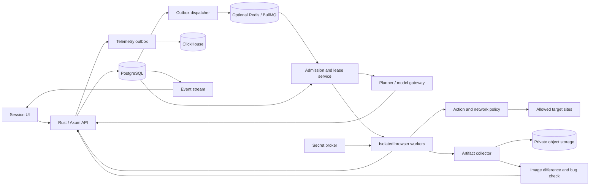

# Browser runtime and orchestration design

Design proposal · 14 October 2026 · Consistency review 21 October 2026

Implementation update, 23 October: the bounded URL explorer now uses a scored frontier over exact recorded states, assessed return routes, stale-plan recovery and desktop/tablet/mobile viewport profiles. See [the implemented planner](../exploration/planner.md), [reproduction](../exploration/reproduction.md) and [workspace](../platform/workspace.md). Implementation update, 30 October: target sites run in `browser-sandbox` containers with no Scout credentials, volumes or storage network, Chromium's own sandbox on and a container restart after every run. Compose starts `SCOUT_BROWSER_SLOTS` of them (default 3). The worker claims every member's jobs up to that many at once, and an interrupted exploration continues in a new run at most three times without repeating a dispatched action. The worker keeps the credentials and drives the sandboxes over Playwright's protocol. See [URL exploration](../exploration/overview.md). The scoped worker API, per-tenant isolation, orchestration and case-management requirements below remain design targets.

This document specifies a browser-testing runtime that could support the session, agent, test-case, bug, replay, and access-request experience shown in the supplied screenshots. The updated direction is a local Docker Compose application with just commands: Rust/Axum API and control plane, TypeScript/Playwright browser worker, PostgreSQL, an S3-compatible evidence bucket, and ClickHouse observability for all model/tool calls. Extra delivery infrastructure is optional later. These are the implementation recommendations. [Local infrastructure](../platform/infrastructure.md) records what is actually tested, including the first fixture recorder. That recorder does not establish autonomous browser exploration or a training dataset.

The user can supply only a URL. The agent infers expected behavior before each browser interaction, captures screenshots before and after it, checks the outcome using image differences and other observations, and preserves the execution trail for future training. A brief adds context but is optional. The detailed capture, mask and dataset contract is in [Evidence and training data](./evidence.md). Video is disabled by default.

The central design choice is to treat an agent as a bounded task with an evidence trail. It may consume a browser slot while running; a waiting agent consumes no browser. A displayed count of 208 agents therefore does not establish that 208 browsers ran concurrently. Build useful exploration, reliable replay, and honest results before increasing agent counts. A `Session` is the conversation; a `Run` is one bounded execution. Deadlines, stop generations, task ownership, and budgets apply to a run. The product specification defines canonical API enums.

## 1. Runtime boundaries

| Component | Responsibility | Why this boundary exists |
|---|---|---|
| Rust / Axum API | Authentication, tenant authorization, session commands, evidence access, event streaming | Keeps the UI contract independent of execution infrastructure. |
| PostgreSQL | Authoritative sessions/runs, task states, attempts, cases, findings, budgets, permissions, durable events and outbox | Allows related changes to commit together and supports auditable recovery. |
| Optional Redis/BullMQ | Wake-ups, delivery, backoff, ephemeral coordination when added | Avoids making queue contents the only record of work or results. |
| Admission service | Machine, workspace, run and target concurrency; time, cost and evidence reservations | A queue worker's local concurrency alone cannot express all product limits. |
| Planner/model gateway | Propose bounded tasks and typed actions; validate structured outputs; record usage | Model decisions stay separate from permissions, browser ownership and billing. |
| Browser worker | Execute approved actions, collect observations, enforce deadlines, clean up | A browser failure cannot take down the API or coordinator. |
| Artifact collector | Every-action before/after captures, redacted derivatives, upload checksums and immutable manifests | Separates capture occurrences from deduplicated image bytes and preserves training provenance. |
| Image/check worker | Raw difference masks, aligned views, tiny-change crops, action assessments | A changed pixel locates evidence; it is not itself a bug verdict. |
| ClickHouse | Append-only operational/action/model telemetry and analytical projections | Supports token/cost and execution analysis without becoming the authoritative scheduler or verdict store. |
| Secret broker | Resolve scoped credentials into an authorized runtime | Queue payloads, prompts and ordinary logs contain references instead of secrets. |

Use one repository and Docker Compose services for the UI/API/controller, browser worker, PostgreSQL, S3-compatible storage, and ClickHouse. Start with one active browser attempt; increase to a measured local pilot cap of three only after evidence and recovery gates pass. Persist database, bucket and upload-journal data in named local volumes; do not publish database/storage/ClickHouse ports broadly. Backups must include both manifests and image objects: local persistence alone is not a backup. Compose describes the services, networks and volumes of a multi-container application. [Docker Compose application model](https://docs.docker.com/compose/intro/compose-application-model/)

Initially claim work directly from PostgreSQL; introduce additional delivery infrastructure only when delivery/backoff requirements justify it. Browser sandboxes receive no database credentials. The current `browser-sandbox` container meets that: it runs only Chromium, while the TypeScript worker that drives it still performs its own storage writes. Moving those writes behind a scoped Rust worker API remains the target. Rust owns API, admission and provider-gateway logic; TypeScript owns Playwright control. Keep the tested image-difference interface; port CPU work to Rust if profiling identifies it as a material bottleneck. Preserve algorithm versions and parity fixtures across implementations.

ClickHouse consumes durable, idempotently identifiable telemetry batches through a replayable outbox. Use action/model IDs for exact query deduplication rather than assuming background table merges remove duplicates immediately. Its outage must not lose evidence or change a verdict; buffer on persistent storage and apply backpressure before disk fills. ClickHouse documents logs, metrics and traces as observability workloads. [ClickHouse observability](https://clickhouse.com/docs/guides/use-cases/observability/build-your-own/introduction)

Playwright is a suitable browser driver because it offers isolated contexts, browser automation and trace tooling. Its contexts separate cookies and storage, including when contexts share a browser. This is a test-state isolation facility, not the security boundary for running unrelated tenants' websites. [Playwright context isolation](https://playwright.dev/docs/browser-contexts)

## 2. Persistent records and invariants

Every record carries `workspace_id`, our tenant key; identifiers alone never authorize access. An environment is an immutable execution configuration revision: starting URL, approved navigation origins, dependency origins, permitted actions, browser profile, account reference, and fixture/reset strategy. A run captures that revision and its budget at creation so later settings changes do not silently change execution. A recheck creates a new run under its session.

| Record | Essential fields |
|---|---|
| `sessions` | ID, workspace, conversation title, creator, archive status, current run |
| `runs` | ID, session, workspace, target URL, environment revision, scope revision, optional brief/context, lifecycle, attention, outcome, stop reason, generation, deadline |
| `tasks` | ID, run, role, parent/dependencies, canonical scenario key, state, queue/block reason, priority, attempt limit |
| `attempts` | ID, task, attempt number, lease token, lease expiry, worker, browser build, profile, start/end, outcome |
| `actions` / `predictions` | Immutable action ID, worker/attempt/page IDs, sequence, typed arguments with secret references, prediction ID, expected transition and provenance frozen before dispatch |
| `observations` / `captures` | Observation ID; distinct capture ID per occurrence; action/phase/time, viewport, scroll, decoded geometry, blob SHA256, bucket key/version, upload state |
| `comparisons` / `checks` | Comparison/check IDs, before/after capture IDs, raw/aligned diff artifact IDs, algorithm version, expectation, actual result, uncertainty and evidence references |
| `cases` / `case_revisions` | Scenario intent, preconditions, assertion contract, ordered steps, input references, author, revision |
| `case_runs` | Case revision, run, attempt, execution state, verdict, assertion results, evidence manifest |
| `findings` | Candidate signature, expected/actual, impact, discovery attempt, reproduction attempt, triage state |
| `artifacts` | Workspace/session/run/attempt, immutable blob key, type, size, checksum, redaction lineage, explicit retention policy; no default expiry |
| `dataset_exports` / `labels` | Versioned manifest, source IDs, transformation versions, consent/scope policy, human versus inferred label provenance, split membership |
| `events` | Session sequence, run ID, entity, event type, safe payload, timestamp |
| `outbox` | Event/command ID, destination, payload reference, delivery state |
| `budget_ledger` | Run, reservation ID, category, reserved amount, actual amount, status |
| `access_requests` | Required capability, affected tasks, secret reference once fulfilled, expiry |

Required invariants:

1. One active attempt lease per logical task. Control and verdict writes carry its lease token and run generation; stale writers cannot change authoritative results. Authenticated, idempotent usage settlement for an existing reservation remains allowed after cancellation, as does bounded artifact finalization associated with that attempt. These late records cannot revive execution or promote a finding.
2. A `verified` case verdict requires evidence for every required acceptance criterion. A worker exit, successful navigation, or absence of reported bugs is insufficient.
3. A `confirmed` functional finding requires a separate completed reproduction attempt with result `reproduced`, its own browser context, evidence, and a justified expectation. Reproducing a behavior does not prove an inferred expectation is correct. Discovery screenshots alone cannot satisfy this condition. Static flags remain a separately labeled kind.
4. A failed automation action is not automatically a product bug. Infrastructure failures, access blocks, uncertain expectations and reproduced product failures have separate categories.
5. Queue retries never erase attempt history. Counts are derived from logical tasks and case runs, with retries shown inside their attempt history.
6. User stop, task completion, budget updates and durable event creation are committed transactions. UI counts come from these records, not model-generated prose.
7. Model output cannot directly insert a final bug, spend a budget reservation, expand network scope, or unlock a secret.
8. Each dispatched browser interaction owns a before/after capture pair and an assessment record, including failed actions. Missing capture/check evidence is recorded explicitly and blocks that worker's next interaction; it cannot be silently skipped to save cost. Evidence operations do not recursively create browser interactions.
9. Identical screenshot bytes may share a blob within the same workspace/security class. Their capture IDs remain distinct occurrences with distinct times and action links. A checksum is not a capture ID.

Use database constraints for uniqueness and foreign keys. Use short transactions for claims and budget reservations; never hold database row locks during browser navigation or a model call. A transactional outbox dispatcher may claim batches using `FOR UPDATE SKIP LOCKED`: PostgreSQL documents that this can suit queue-like consumers, while warning that skipped locks do not provide a general consistent view. [PostgreSQL SELECT locking](https://www.postgresql.org/docs/current/sql-select.html)

## 3. State and queue semantics

Keep the run lifecycle separate from its result summary. A run can finish execution while containing product failures or blocked coverage. Use the same states as the product API:

| Entity | States and meaning |
|---|---|
| Run lifecycle | `created → planning → active → settling → completed`; cancellation uses `stopping → cancelled`; unrecoverable control-plane failure uses `failed`. |
| Attention / result | Attention: `none`, `needs_input`, `budget_limited`. Completed outcome: `clean`, `findings`, `incomplete`, calculated from case verdicts and exclusions. |
| Task | `queued`, `running`, `succeeded`, `blocked`, `failed`, `cancelled`; `queueReason` distinguishes planned/dependency/capacity/ready; `blockReason` identifies access or other missing requirements. Deadline expiry is a failure reason, not a verdict. |
| Case execution / verdict | Execution follows task state. Verdict is independently `unverified`, `verified`, `issues_found`, or `blocked`; uncertain automation keeps unverified coverage and a reason. |
| Functional finding | `suspected`, `reproducing`, `confirmed`, `not_reproduced`, `inconclusive`; independent reproduction result is `reproduced`, `not_reproduced`, or `inconclusive`. |
| Static finding / triage | Static finding state is `flagged` with screenshot evidence. Triage records accepted/intended behavior/cannot reproduce/duplicate/reset independently; a later verified recheck supports a fixed resolution. |

`blocked` with an access reason releases browser capacity. It remains resumable until the run deadline or an explicit user stop; a run with only blocked work can display “Waiting for access” through `needs_input` while its lifecycle remains active. When the deadline arrives, finalize as `incomplete` and preserve the affected cases as blocked. Do not leave leased browsers idle at a login page.

Dispatch protocol:

1. In one database transaction, create the task and outbox message. The outbox references IDs and revisions, never plaintext credentials or full page content.
2. Initially the dispatcher requests admission from durable database task rows. If BullMQ is added, publish a stable delivery ID and then mark delivery. A crash between these operations may produce duplicates; duplicates are expected.
3. A worker requests a task claim. The admission service verifies dependencies, run generation, deadline, account exclusivity and available quota, then issues a lease and budget reservation.
4. If capacity is unavailable, keep the task `queued` with `queueReason: capacity` and a retry-after value. Do not retain an active browser or busy-spin a worker.
5. Before each action, the gateway checks its lease/generation and reserves the entire prediction → before capture → action → after capture → assessment chain. Persist the intent, prediction and before evidence before dispatch. Persist after evidence and a check result before advancing. See the companion's crash-recovery rules; screenshots cannot make website side effects transactional.
6. Complete the attempt, case result, finding candidate, budget reconciliation and outbox events transactionally. Queue acknowledgement follows the database commit.

BullMQ documents at-least-once processing behavior and recommends jobs that tolerate retries. A stalled worker may cause a job to return to waiting or eventually fail. Treat queue delivery as a wake-up, not proof that this worker still owns an attempt. [BullMQ concurrency](https://docs.bullmq.io/guide/workers/concurrency), [idempotent jobs](https://docs.bullmq.io/patterns/idempotent-jobs), [stalled jobs](https://docs.bullmq.io/guide/jobs/stalled)

Unique database keys prevent duplicate result commits, but cannot make website side effects exactly once. If an approved state-changing action might have succeeded before a crash, mark the action `outcome_unknown` and require reconciliation against the target or a reset fixture. Do not automatically replay a payment, deletion, invitation or form submission because the queue retried.

Use fair admission across workspaces, then runs; reserve approximately 25% of each run's spend, action, and browser allowances for reproduction and report completion. Verification should receive prompt service without permanently starving exploration. Queue-wide concurrency can be a backstop, but workspace/run/target limits still need the admission service. [BullMQ global concurrency](https://docs.bullmq.io/guide/queues/global-concurrency)

## 4. Browser lifecycle and isolation

For the local first version, use one fresh browser process/context per attempt and one active attempt across the machine. A later local pilot may raise that cap to three after measured recovery and resource tests. Browser containers are unprivileged, keep the Chromium sandbox enabled, use bounded resources, and reach only the worker API and configured target routes. The controller owns persistent evidence volumes; browser processes do not receive bucket administration credentials, host filesystem mounts, database credentials or the Docker socket. A user-authorized local target gets an explicit route; other control-plane services remain unreachable from target pages.

Compose simplifies local deployment; it does not by itself create a hostile-site security boundary. Before hosted multi-tenant use, place each active attempt in a separately isolated sandbox with enforced external egress, read-only base filesystem, bounded temporary storage and scoped artifact access. Retain the same execution/evidence contracts. Do not assume the local development network is safe for unrestricted third-party sites.

Playwright's Docker guidance warns against treating its stock image as a ready-made environment for untrusted websites. Running browsers as root disables Chromium sandboxing; the documentation describes a non-root user and seccomp configuration for crawling. Our hosted sandbox must be designed and tested beyond simply launching that image. Pin compatible browser and Playwright versions and record them in every attempt. [Playwright Docker guidance](https://playwright.dev/docs/docker)

Attempt lifecycle:

1. Verify task claim; reserve capacity; prepare a fresh temporary directory.
2. Start the browser behind the enforced egress policy. Create a new non-persistent context using the frozen browser profile and, if allowed, an encrypted authentication-state reference.
3. Register page-error, console, network, popup, download and dialog listeners before navigation. Cap event buffers and redact fields at collection.
4. Start the action journal and capture the initial blank/open page. Navigation itself receives prediction, before/after screenshots and a check; it is not an unrecorded setup exception.
5. Execute each bounded interaction through the evidence chain. Emit structured progress and record model/tool inputs, outputs, versions and usage after redaction. Keep hidden model reasoning out of the dataset.
6. Close the context after the last action check; finalize the manifest, upload pending evidence, commit results, and reconcile actual usage. Screenshot/action replay is the default; do not start a video recorder.
7. In all exit paths, close browser resources and revoke temporary credentials. Delete temporary capture files only after verified bucket persistence or transfer to the durable retry spool. A supervisor force-terminates the sandbox if cleanup exceeds its grace period; an uncollected final frame remains a visible evidence gap.

Implemented local profiles are desktop Chromium at 800 × 600, tablet at 768 × 1024, and mobile at 390 × 844. They change responsive viewport geometry, with device scale 1 and separate browser contexts. Native-device user agents/touch emulation and a larger desktop profile remain possible extensions. The broader environment contract should store viewport, user agent, touch behavior, device scale, locale, timezone, color scheme and browser build. Do not report mobile Chromium as testing physical iOS or Mobile Safari. Actual engine coverage must be added as distinct projects. [Playwright emulation](https://playwright.dev/docs/emulation)

Use explicit page readiness and locator assertions rather than arbitrary long sleeps or requiring all network traffic to become idle. Streaming dashboards may never be network-idle. Prefer semantic locators with stable identity, require a unique match, and use Playwright's visibility, stability, enabled-state and event-receiving checks. A forced click can hide a real obstruction and should not be a default repair. [Playwright actionability](https://playwright.dev/docs/actionability)

One task owns its pages serially. Bound popups, tabs and navigation depth; close out-of-scope popups with a recorded reason. Parallel agents must not race over the same page. Reproduction receives a fresh context and a new sandbox; it must not inherit accidental state from exploration.

## 5. Exploration, execution and reproduction

A URL alone starts the planner. It proposes product areas and task intents from the initial page and discovered navigation, supplemented by an optional brief/spec. Before each interaction, record an expected state transition, the observable signals that would support it and whether the expectation is user-specified or inferred. For example, a filter click predicts a changed selected state and an updated result set; a hover may predict only a tooltip. Do not rewrite the prediction after observing the outcome. A coordinator deduplicates intents by route family, user role, viewport and expected behavior.

The model receives a compact observation containing current URL, safe visible text, relevant DOM/accessibility structure, screenshot references, recent action results and remaining budget. It can propose only typed actions such as navigate, inspect, click, fill, choose, scroll and assert. The trusted executor resolves locators and enforces action scope. Arbitrary shell commands, browser debugging sockets and unrestricted code evaluation are not part of the agent tool interface. Implement vetted measurement functions for DOM geometry and other deterministic checks.

Each recorded case needs a precondition, an action sequence and an assertion contract. For example: “At 390 × 844, open About; the first statistic's text must be fully within the content viewport.” Record where the expectation came from: explicit requirement, existing case, accessibility rule, or inferred UI intent. Inferred intent supports a candidate for review; it should not be presented as an authoritative product specification.

Every interaction gets a bug check before the next interaction: compare before/after frames, inspect raw and aligned difference masks/crops, check predicted UI/DOM/network changes, and record `no_issue_observed`, `suspect`, `blocked` or `inconclusive` as an action-level assessment. These do not replace canonical case verdicts. Tiny visual changes are retained even when they are one pixel or a subtle focus/border change. A zero-difference image can be correct, a blocked action, an invisible state change or a defect; it never automatically passes the check. A large change is equally not proof of success. Independent reproduction follows suspected defects later, with the same full evidence chain.

Deterministic smoke checks establish the first useful layer: navigation failures, uncaught page errors, visibly broken loaded images, persistent horizontal clipping, and a bounded set of allowed navigation links. Each needs exclusions: intentionally scrollable regions are not necessarily overflow bugs; a third-party analytics error is not necessarily a user failure; a lazy image not yet requested is not broken; a login gate is not a defect when it matches the intended access rule.

Reproduction protocol:

1. Freeze the candidate's expected/actual result, reproduction steps, account role, route, browser profile and environment revision. Retain its original observations.
2. Dispatch a separate verifier with that scenario and evidence requirements. Give it the expected behavior and steps without directing it to confirm the discovery's conclusion.
3. Start from a clean browser and known application data. Recreate the issue through the same public UI path; using the same authentication template is permitted, inheriting the live exploration context is not.
4. Evaluate the same assertion and capture fresh before/after evidence. Include bounding boxes or response facts when they substantiate a visual or navigation failure.
5. One independent successful reproduction records result `reproduced`. Promote the functional finding to `confirmed` only with validated evidence and an expectation justified by a requirement, reliable specification, unambiguous UI contract or demonstrable invariant. Reproduced disagreement with an inferred goal remains an uncertain candidate. A completed replay that does not observe the claimed defect yields `not_reproduced`; unavailable access, automation errors, environmental changes or uncertain evidence yield `inconclusive`. Repeated intermittent results retain attempt counts instead of an invented certainty score.
6. Deduplicate by route family, assertion, affected element and symptom; preserve viewport-specific manifestations and all evidence. Do not merge unrelated failures merely because their wording resembles each other.

A second fresh browser does not reset server-side data. Stateful journeys need account leasing, seeded data and cleanup/reset contracts. Without those, describe reproduction limits explicitly. “Verified” should mean a defined assertion was checked; the UI must not interchange it with “agent finished” or “candidate reproduced.”

## 6. Network scope, action scope and secrets

Separate navigation origins, dependency origins and allowed mutation capabilities. An app may need a CDN or API on another origin without granting permission to explore that origin or send customer data to arbitrary destinations. OAuth redirects require explicit environment configuration. External links can be recorded as coverage exclusions until their destinations are authorized.

Enforce network restrictions outside the page as well as in the browser driver. The egress proxy/firewall must validate resolved addresses, every redirect and destination connection; reject private, loopback, link-local, metadata and reserved ranges in hosted mode, including IPv6 and alternative IP encodings. Prevent DNS rebinding and block unapproved direct UDP, QUIC, WebRTC and DNS paths. URL validation at session creation alone cannot protect all subresources and subsequent requests. These controls follow the application/network separation and address-validation principles in [OWASP's SSRF prevention guidance](https://cheatsheetseries.owasp.org/cheatsheets/Server_Side_Request_Forgery_Prevention_Cheat_Sheet.html).

Localhost testing belongs in an explicit local runner or private-environment connector with a tenant-specific route allowlist. Do not let a hosted session's `localhost` reach the worker host or control plane. Browser `route` hooks help collect and restrict ordinary requests, but are not the only network security boundary. Playwright documents service-worker interception caveats; when service workers are blocked for a controlled run, record that configuration because it can change app behavior. [Playwright network handling](https://playwright.dev/docs/network)

Default exploration allows observation and approved low-impact navigation. A rule that merely blocks POST requests is insufficient: reads can use POST and poorly designed mutations can use GET. Define permitted workflows and use a staging environment with seeded accounts when testing writes. Record approvals as capabilities attached to an environment revision; do not repeatedly ask for actions already within that scope. Purchases, wallet transactions, public messages and destructive actions need explicit authorized scenarios and application-specific test controls.

Keep observed page text, uploaded instructions and network responses in the untrusted observation channel. They cannot change the task's allowed domains, budget, credentials or execution policy. An instruction embedded in a page to send secrets elsewhere is page content, not a user command.

Secrets are entered through a dedicated access form and resolved through an encrypted local vault/secret broker; a managed key service can replace local key management when hosted. Workers obtain scoped access for the allowed login origin. Record login, fill and authenticated interactions in the same before/after chain, with secret IDs replacing values in ordinary arguments, prompts and logs. Keep raw captures encrypted and access-restricted where permitted, and produce separately identified redacted derivatives for UI/model/training access. If policy prohibits capturing a sensitive region, record its capture-time redaction rather than pretending the original pixels exist. Playwright authentication state can contain impersonation-capable cookies and headers; store it in the vault, not the general training dataset. [Playwright authentication](https://playwright.dev/docs/auth)

When login is needed, create one durable access request and block only dependent tasks. Continue eligible public work. On access arrival, record an explicit run-context amendment referencing the new credential/environment version, then issue new attempts against that revision. Preserve the original run snapshot and earlier blocked results; never silently change the target, acceptance criteria, or allowed actions. For concurrent state-changing scenarios, lease distinct accounts or serialize work over the same account; browser contexts do not isolate backend account state.

## 7. Evidence, replay and live viewing

Every attempt preserves an immutable, linked timeline of all dispatched interactions, failures, model calls and assessments, not just bug examples. Each screenshot occurrence receives a unique `capture_id`; workers/actions/checks refer to it. Encoded PNG bytes have a separate SHA256 blob identity for integrity and optional same-workspace deduplication. The local S3-compatible bucket is configured as `qa-evidence`; see the infrastructure document for actual availability and verification. PostgreSQL stores metadata and relationships, the bucket stores captures/masks/manifests, and ClickHouse stores queryable telemetry projections.

Replay uses the ordered screenshot chain, action arguments, predictions, difference-mask overlays and check results. This allows inspection of subtle state changes without video. Trace collection is an optional diagnostic mode; Playwright traces can expose page snapshots and network activity, so their redaction/access rules remain separate. [Playwright Trace Viewer](https://playwright.dev/docs/trace-viewer)

Video is disabled by default. Raw traces/HAR are also opt-in diagnostics, not substitutes for the required screenshots. Request headers, bodies, DOM snapshots and pixels may contain secrets. Keep protected raw evidence separate from redacted derivatives; masking a model input never overwrites the source capture. Dataset manifests state any collection-time exclusions. The system cannot promise every transient pixel: configurable bounded extra captures observe toasts/animations while the ordinary before/after pair remains mandatory.

Use private object storage and an authorization-checked download gateway. Short-lived URLs are access grants, never capture identities. Preserve the execution/training corpus by default: no automatic seven/thirty-day evidence deletion and no lifecycle expiry on the bucket. An explicit retention/export/deletion policy governs raw evidence, redacted derivatives, snapshots, backups and training exports. Immutability prevents silent replacement; it does not prevent an authorized audited deletion. Storage quotas pause new interactions before losing evidence; they do not silently evict older runs. Reconcile orphaned uploads against manifests before any cleanup.

For the first version, “live view” can mean timestamped screenshots updated during active steps. Label it honestly. Interactive takeover needs a distinct exclusive-control lease: suspend the agent, grant one operator control, record the handoff, then resume only after a new observation. A Playwright/CDP endpoint must never be exposed directly to the user's browser or the public network.

## 8. Capacity, cost and deadlines

The following are proposed limits, to be tuned from measured workload data. Initial implementation runs one active browser attempt. The three-attempt settings apply only to a later local pilot after concurrency and recovery tests pass.

| Limit | Initial setting |
|---|---|
| Active browser attempts per run | 1 initially; up to 3 in the measured local pilot |
| Active browser attempts per target origin | 1 initially; up to 2 in the measured local pilot unless explicitly configured otherwise |
| Active browser attempts on local machine / per workspace | 1 initially; 3 total in the measured local pilot; any later hosted increase is explicit |
| Open pages per attempt | 3 including popups |
| Unique navigation targets per run | 12; maximum link depth 2 |
| Logical tasks per run | 30, including exploration and reproduction tasks |
| Browser actions per run | 120; typed action count, not raw internal Playwright calls |
| Run wall-clock allowance | 15 minutes; access waits consume this by default |
| Aggregate browser runtime | 1,200 browser-seconds; three workers for 400 seconds exhaust it |
| Per-navigation / ordinary action timeout | 30 seconds / 10 seconds |
| Per-attempt deadline | 90 seconds; longer scenario classes require an explicit configuration |
| Model calls | Configurable cap covering prediction and assessment for every admitted action; at most 260 for 120 actions plus planning, still constrained by spend/time caps |
| Evidence per action | Mandatory before/after PNGs and check; up to 3 additional transient captures within a bounded 2-second observation window when warranted |
| Storage admission | Reserve capture/diff/check bytes before acting; pause on full disk/bucket/spool rather than dropping records |
| Infrastructure retry | At most 1 automatic retry for an eligible read-only attempt |
| Cleanup grace | 10 seconds outside useful execution allowance |

Reserve capacity for each complete action chain, including its after capture and check, before dispatch. For providers with enforceable request/output bounds, reserve the corresponding upper cost bound. Otherwise record an estimate and enforce supported call/time/concurrency limits; do not promise a hard dollar ceiling on a subscription route lacking an enforceable output cap. Provider capabilities and restrictions are specified in [Local stack and models](../platform/models.md).

Each model call records request ID, workspace/user/provider-connection attribution, worker/action/check links, provider/model/prompt versions, input/output/cached tokens where reported, image usage where reported, latency, retries and settled cost or unknown-cost status. PostgreSQL maintains the idempotent usage ledger; ClickHouse supports token totals and per-action/worker/run investigations. Cache/reasoning subcategories must not be added again when already included in parent totals. Unknown provider fields remain unknown rather than zero. Keep API cost estimates, settled charges, and subscription entitlement usage distinct. Do not infer actual image tokens from PNG size or present estimates as a settled invoice amount. Record browser seconds, image-worker CPU, upload/storage bytes and comparison latency separately.

Admission requires `settled + outstanding reservations + proposed reservation ≤ run cap` in the relevant accounting dimension. This is a hard cost bound only where reservations are backed by enforceable provider limits; with estimated reservations it is an estimated spending guard. Once exhausted, stop new work and finalize remaining tasks with an explicit budget reason. Already-dispatched provider requests may still incur charges or consume subscription usage after cancellation; do not claim an instantaneous zero-cost stop or an unverified maximum. Report measured usage and any unpriced external component separately.

On the single local machine, use bounded backpressure and show resource pressure instead of autoscaling. Monitor browser/image-worker CPU and memory, queue age, capture/upload/check latency and corpus growth in ClickHouse. Optional hosted scaling later remains bounded by budgets and target limits. The number of logical agents is a poor scaling metric; browser-slot utilization, evidence completeness, reproduced-findings rate, token usage and false-positive rate are more useful.

## 9. Cancellation, crash recovery and UI consistency

The stop command commits `stopping` and increments the run generation. New task claims fail immediately after that transaction; each action gateway rejects older generations. Notify workers through a fast channel, with database checks as the durable fallback. Abort pending model calls where supported, close pages and revoke the execution lease. An action already dispatched to a website may finish; the audit log records that boundary rather than promising reversal. Mark `cancelled` after resource teardown is acknowledged. Release unused reservations only; retain in-flight amounts until authenticated idempotent settlement completes, even after cancellation.

Workers heartbeat leases, for example every ten seconds with a forty-five-second expiry. Before reassigning an expired browser attempt, terminate its sandbox or revoke its egress/control lease and confirm it can no longer act. A fencing token prevents stale database commits, but alone cannot stop an orphaned browser interacting with a target. Mark the old attempt lost; retry only eligible scenarios from a fresh context. Preserve uncertain state-changing outcomes for reconciliation.

Recovery scenarios:

| Failure | Required behavior |
|---|---|
| API restart | Recover sessions from PostgreSQL; continue durable outbox delivery. |
| Dispatcher crash after publish | Duplicate wake-up is ignored by task claim/unique keys. |
| Browser crash | Preserve completed observations; classify infrastructure failure; bounded eligible retry. |
| Redis loss, if introduced | Reconstruct pending wake-ups from the database ledger; do not reconstruct truth from queue history. |
| PostgreSQL unavailable | Fail closed for new claims/actions when validity cannot be checked; stop safely after a short bounded outage. |
| Artifact storage unavailable | Retry uploads within limits; mark evidence incomplete rather than silently claiming reproducibility. |
| Crash after action dispatch but before after capture | Preserve intent/before evidence and mark uncertain outcome/missing capture; do not manufacture an after frame or replay a possibly completed mutation. |
| ClickHouse unavailable | Buffer/replay telemetry from durable outbox; verdicts stay in PostgreSQL; pause new work if the persistent buffer fills. |
| Worker lost after form submission | Mark uncertain external outcome; reconcile/reset before any replay. |
| Stop racing with completion | Database transaction ordering decides whether completion was already accepted; no resurrection of stopped tasks. |

Events have monotonic sequence numbers per session. Deliver them through SSE with a cursor and a snapshot endpoint for reconnects; polling is an acceptable first implementation. Persist public events in the same transaction as the state change. The UI ignores duplicates, applies events in order and refreshes its snapshot on a sequence gap. “Waiting for capacity” and “Waiting for access” are distinct visible reasons. Replayed events do not duplicate chat messages.

## 10. Implementation sequence and acceptance gates

| Phase | Deliverable | Acceptance gate |
|---|---|---|
| 0. Local data foundation | Compose, PostgreSQL, ClickHouse, S3-compatible `qa-evidence` bucket and reference screenshot archive | Upload/read back the seven references by unique capture ID and verify restart persistence; consult the infrastructure document for results. No browser-testing claim follows from this gate. |
| 1. Local evidence runtime | Docker Compose, TypeScript/Playwright, PostgreSQL, S3-compatible bucket, ClickHouse, mandatory action capture/check chain, fixture site | Every dispatched action has linked before/after/check records or an explicit interruption; one-pixel and transient fixtures retain their evidence; no video starts. |
| 2. Durable orchestration | PostgreSQL schema, direct task claims, outbox, leases, cancellation, recovery, usage ledger; optional BullMQ delivery later | Fault injection proves duplicate delivery does not duplicate committed results, lost workers are contained, and caps hold under concurrent dispatch. |
| 3. Exploration and reproduction | URL-only start, pre-action inferred predictions, mask-assisted checking, site map, candidate recording, separate verifier | Every interaction is checked; ambiguous inferred intent stays labeled; every reproduced issue has separate evidence; changing the fixture prevents invented confirmation. |
| 4. Authenticated workflows | Secret broker, environment revisions, account leasing, access requests, reduced safe evidence mode | Secrets stay out of prompts, ordinary logs and exported evidence; access resumes only dependent work; concurrent account state is controlled. |
| 5. Local pilot and dataset export | Session UI/events, evidence/diff viewer, versioned training manifests, human labels, operational dashboards, explicit retention/export/deletion | Reconnect restores exact counts; every exported sample traces to immutable captures/actions/predictions/checks; raw secrets are excluded from standard training exports. |
| 6. Follow-up operations and optional hosting | Case editing/versioning, schedules, CI, stronger hosted tenant/egress isolation, optional distributed queue | Hosted boundaries pass security/recovery tests before unrelated tenants run; schedules use frozen revisions. |

The browser runtime and durable orchestration should be proven before autonomous multi-agent exploration. Start with Chromium and a small action vocabulary. Add more browsers, richer assertions, code export and broad integrations after a reliable case lifecycle exists. These are delivery gates rather than promised calendar dates; staffing and target app complexity determine the schedule.

Concrete acceptance suite:

1. **Real defects:** a controlled fixture includes one broken visible image, a mobile clipping defect and a dead same-origin link. Discovery and separate replay produce evidence for each. A deliberate scroll container and lazy image remain clean.
2. **Honest failures:** CAPTCHA, expired auth, DNS failure and intentional access denial produce blocked/infrastructure results, not confirmed product bugs.
3. **Isolation:** two tenants and two accounts set distinguishable cookies/storage. No attempt sees another's state; a malicious page cannot reach control-plane services or another tenant's artifact.
4. **Egress:** reject private/metadata addresses through redirects, DNS rebinding, IPv6, subresources, WebSockets and direct network paths. The explicitly configured local runner still reaches its intended test app.
5. **Queue recovery:** kill a worker after claim, after evidence upload and after result commit. Recovered work has one authoritative outcome, retained attempts and no uncontrolled surviving browser.
6. **Cancellation:** stop while waiting, navigating, uploading and calling a model. No later action is newly admitted; resources are reclaimed within the defined deadline and in-flight costs are reconciled.
7. **Budget race:** dispatch more eligible tasks than remaining capacity/cost permits. Total reservations stay within the cap even with duplicate queue delivery and a concurrent stop. Exercise a provider route without an enforceable output cap; the UI must label its cost guard as estimated and enforce only supported hard limits.
8. **Reproduction integrity:** remove a seeded bug between discovery and replay. The finding becomes not reproduced or inconclusive, never automatically confirmed from its first screenshot.
9. **Secret handling:** seed a canary credential into login inputs, cookies, responses and visible account data. Inspect every permitted export, model input and log; classify any leakage as a release blocker.
10. **Stateful uncertainty:** simulate a crash immediately after a test write. The system records an unknown outcome and does not replay before fixture reset or target reconciliation.
11. **Evidence lifecycle:** interrupt an upload, repeat identical frames, revoke access and perform an explicitly authorized dataset deletion. Every occurrence keeps its own capture ID, checksums detect corruption, no automatic expiry removes the corpus, and deletion reconciles derivatives/exports.
12. **UI consistency:** reconnect from old and missing event cursors, replay duplicate events and restart the API. Case totals, active agents and messages match the database snapshot.
13. **Tiny-change checks:** seed a one-pixel border change, disabled-state shift, focus ring, unchanged screenshot with a DOM state change, intentional animation and scroll. Raw masks retain tiny deltas; aligned/noise-ranked views never erase source evidence; zero delta never automatically passes.
14. **Training provenance:** export a versioned dataset containing successful, failed, blocked and interrupted actions. Distinguish inferred predictions, model assessments, independently reproduced findings and human labels; a changed redaction/label policy produces a new export version.
15. **Token and telemetry recovery:** duplicate provider-usage events and stop during a model request while ClickHouse is unavailable. PostgreSQL settles once, the analytical projection catches up without double counting, and the execution trail preserves reported token usage.

The first release is ready when a user can submit an authorized application URL, watch a bounded run, understand blocked coverage, inspect independently reproduced findings, and rerun a saved case with comparable evidence. Large agent counts and fluent narration are not acceptance criteria.
